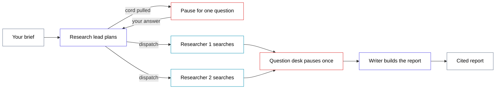

# andon-cord — diagram

## Mermaid (drop straight into the guide)

Red outlines mark the only two places the line can stop. Everything else runs
without you.

The human is not a box. That is the design, not an omission: the graph emits a
question and waits for a dict of answers, and who supplies it — a terminal, a
fixture, a web page — is not the graph's business. Drawing a "you" node would put
the one thing that lives outside the graph inside the picture of it.

Nine arrows from six edge declarations in `src/graph.py`: the conditional edge
after the lead accounts for three of them, and the single `researcher` node draws
two into the desk because two copies run at once.

---

## ChatGPT prompt — clean SVG version

> Draw a horizontal flow diagram as a single inline SVG, 1600x600, on a white
> background. Thin 2px rounded rectangles, white fill, black 16px label text,
> generous whitespace.
>
> One straight line across the middle, left to right: "Your brief" (grey outline)
> arrow to "Research lead" (indigo) arrow to a pair of stacked boxes
> "Researcher 1" and "Researcher 2" (both cyan, one above the other, both fed by
> the same arrow) arrow to "Question desk" (red) arrow to "Writer" (indigo)
> arrow to "Cited report" (grey).
>
> One box sits off that line: "Pause for one question" (red), above the research
> lead, with a short arrow up from the lead and a short arrow back down into it.
> That is the only detour.
>
> Label the up arrow "cord pulled" and the down arrow "your answer", both in small
> grey text. Label the arrow from the lead to the researchers "runs without you".
> Under the question desk, small grey caption: "both questions, one interruption".
>
> Do not draw a box for the human. The two red boxes are where the line stops for
> a person, and the caption carries that; adding a figure would put the one thing
> that lives outside the system inside the diagram of it. No gradients, no drop
> shadows, no icons, no logos.

## ChatGPT prompt — illustrated version

> A clean editorial illustration, 16:9, of a factory assembly line seen from the
> side in flat vector style, muted paper-white background. Three small worker
> figures stand at stations along a single belt moving left to right. Two of the
> workers have a thin cord running up from their station to a single overhead
> rail. The cords from both workers meet at one handle. A fourth figure, larger
> and standing apart at the end of the line, holds that single handle.
>
> The point to communicate: many workers, one cord, one interruption. Limited
> palette of indigo, cyan and one red accent on the cord only. No text, no
> machinery detail, no clutter.
