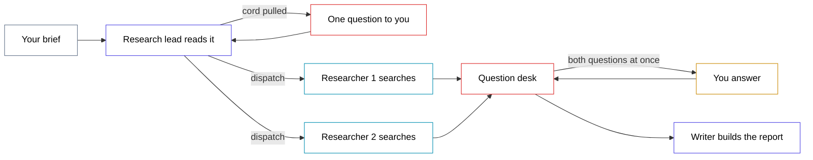

# andon-cord — diagram

## Mermaid (drop straight into the guide)

Red outlines mark the only two places the line can stop. Everything else runs
without you.

---

## ChatGPT prompt — clean SVG version

> Draw a horizontal flow diagram as a single inline SVG, 1600x600, on a white
> background. Eight boxes left to right, thin 2px rounded rectangles, white fill,
> black 16px label text, generous whitespace.
>
> Row 1 (the main line, straight across the middle): "Your brief" (grey outline)
> arrow to "Research lead" (indigo) arrow to a pair of stacked boxes
> "Researcher 1" and "Researcher 2" (both cyan, one above the other, both fed by
> the same arrow) arrow to "Question desk" (red) arrow to "Writer" (indigo)
> arrow to "Report" (grey).
>
> Above the lead, one box "One question to you" (red) with a short arrow up from
> the lead and a short arrow back down into it. Below the question desk, one box
> "You answer" (amber) with an arrow down from the desk and an arrow back up.
>
> Label the arrow from the desk to "You answer" with the small grey text
> "both questions, one interruption". Label the arrow from the lead to the
> researchers "runs without you".
>
> Only the two red boxes and the amber box may touch the human. Make that read
> instantly: everything on the straight horizontal line is automatic, and the
> only detours off it are the two stops. No gradients, no drop shadows, no icons,
> no logos.

## ChatGPT prompt — illustrated version

> A clean editorial illustration, 16:9, of a factory assembly line seen from the
> side in flat vector style, muted paper-white background. Three small worker
> figures stand at stations along a single belt moving left to right. Two of the
> workers have a thin cord running up from their station to a single overhead
> rail. The cords from both workers meet at one handle. A fourth figure, larger
> and standing apart at the end of the line, holds that single handle.
>
> The point to communicate: many workers, one cord, one interruption. Limited
> palette of indigo, cyan and one red accent on the cord only. No text, no
> machinery detail, no clutter.
