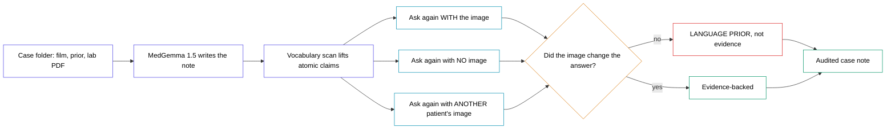

# second-read — diagram assets

## 1. Mermaid (for the guide, section 3)

## 2. ChatGPT — SVG code (use this one first)

> Draw a clean landscape SVG flow diagram, 1600x700, white background, black text, no gradients, no drop shadows, no icons.
>
> Left to right, four columns.
>
> Column 1, one rounded rectangle with an indigo (#4f46e5) 2px outline: "Case folder — chest film, prior study, lab PDF".
>
> Column 2, two stacked indigo-outlined rectangles connected downward: "MedGemma 1.5 writes the note", then "Vocabulary scan lifts each claim".
>
> Column 3, three cyan (#0891b2) outlined rectangles stacked vertically, each with an arrow from the "Vocabulary scan" box: top "Ask again WITH the image", middle "Ask again with NO image", bottom "Ask again with ANOTHER patient's image". Label the three arrows in small grey text: "sighted", "blind", "shuffled".
>
> Column 4, an amber (#d97706) outlined diamond "Did the image change the answer?" receiving all three, then two boxes to its right: a red (#dc2626) outlined one reading "LANGUAGE PRIOR — not evidence" from the "no" branch, and a green (#059669) outlined one reading "Evidence-backed" from the "yes" branch. Both flow into a final green-outlined rectangle "Audited case note".
>
> Draw a thin vertical dashed grey line between column 2 and column 3, labelled in small italic grey text above it: "everything left of this line is what a normal demo ships".
>
> All fills white. All text black except the small arrow labels and the divider caption, which are grey. Use a clean sans-serif. Keep at least 24px of padding around everything.

## 3. ChatGPT — image generation (for the carousel)

> A clean, minimal, editorial-style infographic on a white background, landscape 16:9. Left to right: a chest X-ray thumbnail feeding into a block labelled "the model writes the report", then that report splitting into three parallel test lanes labelled "with the image", "without the image", "with someone else's image". The three lanes converge on a single decision point, which splits into two outcomes: one marked in red reading "said it anyway", one marked in green reading "actually looked". Flat vector style, thin 2px outlines, indigo and cyan and amber accents on white, black sans-serif labels, generous white space, no photographic elements, no 3D, no glow.

## Why the divider matters more than the boxes

Everything left of the dashed line is the project every MedGemma tutorial ships: an image goes in, a radiology report comes out, and it reads beautifully. The three lanes to the right are the whole difference. They cost two extra forward passes per claim and they are the only thing in the diagram that can tell a reading from a recitation.
