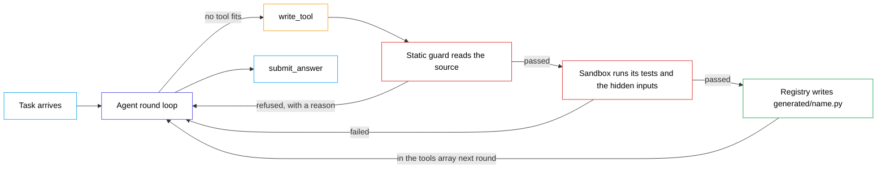

# toolsmith — architecture diagram

Three ways to get the same picture. The Mermaid block is what goes in the
guide. The SVG prompt is the one to use with ChatGPT when you want a clean
image for the carousel.

---

## Mermaid (drop straight into the guide)

---

## ChatGPT prompt — SVG (use this one)

Ask for SVG rather than an image. An image model gets the boxes right and the
label text wrong, and a diagram with misspelt labels is useless. SVG comes back
correct, stays editable, and exports to PNG at any size.

> You are a technical illustrator. Produce a single self-contained SVG file for
> a software architecture diagram. Output only the SVG code, nothing else.
>
> **Canvas:** 1600 × 560, white background, 40px padding on all sides.
>
> **Layout:** one main row running left to right, with one feedback arrow
> returning above the row and one exit arrow dropping below it. Boxes are
> rounded rectangles, 8px corner radius, 2px stroke, white fill, evenly spaced
> with clear gaps. Do not overlap any box, arrow or label.
>
> **The row, left to right:**
> 1. `Task arrives`
> 2. `Agent round loop` — draw this one slightly taller and heavier; it is the hub
> 3. `write_tool`
> 4. `Static guard` with the smaller caption `reads the source`
> 5. `Sandbox` with the smaller caption `runs its tests and the hidden inputs`
> 6. `Registry` with the smaller caption `writes generated/name.py`
>
> **Arrows along the row:** plain arrows between consecutive boxes. Label the
> arrow from `Agent round loop` to `write_tool` with `no tool fits`. Label the
> arrow from `Static guard` to `Sandbox` with `passed`, and the arrow from
> `Sandbox` to `Registry` with `passed`.
>
> **Two return arrows**, curving back under the row to the left edge of
> `Agent round loop`: one from `Static guard` labelled `refused, with a reason`,
> one from `Sandbox` labelled `failed`. Keep these two visually quieter than
> the main row.
>
> **One feedback arrow** curving over the top of the row, from `Registry` back
> to the top of `Agent round loop`, labelled `in the tools array next round`.
> This is the most important arrow in the diagram — draw it in the accent
> colour and slightly thicker than the others.
>
> **One exit arrow** dropping from the bottom of `Agent round loop` to a final
> box `submit_answer` placed directly below it.
>
> **Colour** — white fills throughout, black label text, coloured strokes only:
> - `Task arrives` and `submit_answer`: `#0ea5e9`
> - `Agent round loop`: `#4f46e5` (also the accent for the feedback arrow)
> - `write_tool`: `#f59e0b`
> - `Static guard` and `Sandbox`: `#dc2626` — these two are the checks
> - `Registry`: `#16a34a` — this is where a tool is accepted
> - arrows and their labels: `#475569`, except the feedback arrow
>
> **Type:** a clean grotesque sans (Inter, Helvetica, Arial as fallbacks).
> Box labels 20px, medium weight, black. Captions 14px, `#64748b`. Arrow
> labels 15px, medium weight. No text smaller than 14px.
>
> **Do not include:** a title, a legend, icons, clipart, emoji, drop shadows,
> gradients, 3D effects, background patterns, or any element I have not listed
> above. Flat 2D line art only. Every label must be spelled exactly as written.

### If the first result is cluttered

> Redo it with more breathing room: increase the gaps between boxes, move each
> arrow label further from the line it belongs to, and make sure no label
> touches or crosses any arrow or box. Keep everything else identical.

---

## ChatGPT prompt — rendered image (only if you want a picture, not a diagram)

Text in generated images is unreliable, so use this for a stylised header
graphic rather than for the real architecture diagram.

> A clean, flat 2D technical architecture diagram on a pure white background.
> Six rounded rectangles in a single left-to-right row, thin coloured outlines,
> white fills, connected by thin grey arrows, with one prominent indigo arrow
> curving over the top of the row and back to the second box. Minimal Swiss
> design, generous white space, no icons, no shadows, no gradients, no 3D.
> Wide landscape composition.
>
> `--ar 16:9 --style raw --v 7`

---

## What the diagram has to get right

If you redraw it by hand, these are the parts that carry the meaning:

- **The arrow returning to the loop** is the whole project. A tool written this
  round is in the tools array next round. Everything else is machinery.
- **The guard and the sandbox are two separate boxes**, not one. They catch
  different things, and the diagram should not imply a single gate.
- **A refusal goes back to the agent**, it does not end the run. Both return
  arrows exist so the reader sees that a rejected tool is a repair attempt.
- **The registry is the accept step** and is the only green box.
