# understudy — architecture diagram

The Mermaid block is the plain version. The SVG prompt is the one to paste into
ChatGPT for the carousel image, and it matches the icon-and-tint style used for
the toolsmith diagram.

The guide's section 3 carries a simpler pipeline-only Mermaid. This file's
version adds the two arms and the verdict, because those are what the carousel
needs to show.

---

## Mermaid (plain version)

```mermaid
flowchart LR
    Export[WhatsApp export] --> Parse[Parse one regex every locale]
    Parse --> Clean[Pair and clean PII out]
    Clean --> Files[train 212 heldout 43 stranger 43]
    Files --> Kaggle[Kaggle T4 LoRA 60 steps]
    Kaggle --> Resp[responses.json raw numbers only]
    Resp --> Score[score on your laptop]
    Score --> Voice[Voice moved 3.363 nats]
    Score --> Facts[Facts 1 of 20 the rest invented]

    style Export fill:#ffffff,stroke:#0ea5e9,color:#000000
    style Parse fill:#ffffff,stroke:#f59e0b,color:#000000
    style Clean fill:#ffffff,stroke:#f59e0b,color:#000000
    style Files fill:#ffffff,stroke:#0ea5e9,color:#000000
    style Kaggle fill:#ffffff,stroke:#4f46e5,color:#000000
    style Resp fill:#ffffff,stroke:#0ea5e9,color:#000000
    style Score fill:#ffffff,stroke:#4f46e5,color:#000000
    style Voice fill:#ffffff,stroke:#16a34a,color:#000000
    style Facts fill:#ffffff,stroke:#dc2626,color:#000000
```

---

## ChatGPT prompt — SVG (use this one)

Ask for SVG, not a picture. An image model gets the boxes right and the label
text wrong, and a diagram with misspelt labels is useless. SVG comes back
correct, stays editable, and exports to PNG at any size.

> You are a technical illustrator. Produce a single self-contained SVG file for
> a software architecture diagram. Output only the SVG code, nothing else.
>
> **Canvas:** 2100 × 780, white background, 48px padding on all sides.
>
> **Style:** rounded rectangles, 14px corner radius, 2.5px coloured stroke, a
> very light tint of the stroke colour as the fill (not pure white). Each box
> has a small flat vector icon inside it at the top-left, in the box's own
> stroke colour. Bold near-black titles, and a smaller grey caption line under
> the title where one is given. Flat 2D only. Generous spacing, nothing
> overlapping.
>
> **Main row, left to right, evenly spaced:**
> 1. `WhatsApp export` — caption `Export Chat, Without Media` — chat-bubble icon
> 2. `Parse` — caption `one regex, every locale` — magnifying-glass icon
> 3. `Pair and clean` — caption `bursts merge, numbers redacted` — funnel icon
> 4. `Three JSONL files` — caption `train 212 · held out 43 · control 43` — stacked-documents icon
> 5. `Kaggle T4` — caption `LoRA r=32, 60 steps, 5.5 min` — GPU-chip icon — draw this box taller and heavier, it is the hub
> 6. `responses.json` — caption `raw numbers, no verdict` — file icon
> 7. `score` — caption `verdict on your laptop` — bar-chart icon
>
> **Arrows along the row:** plain arrows between consecutive boxes, with small
> lowercase labels sitting above the line: `811 messages` between boxes 1 and 2,
> `255 pairs` between 3 and 4, `upload` between 4 and 5, `download` between 6
> and 7.
>
> **Two small boxes stacked directly under `Kaggle T4`**, both feeding into
> `responses.json` with short arrows:
> - `adapters on — tuned arm`
> - `adapters off — base arm`
>
> Put a small grey caption under that pair reading `one set of weights, measured
> twice`. Draw these two in the same indigo as `Kaggle T4` but lighter.
>
> **One thick feedback-style arc over the top of the row**, spanning from the
> top of `Kaggle T4` across to the top of `score`, drawn as a thick rounded
> indigo pill containing white text: `the GPU renders no verdict — every
> threshold lives on your laptop`. This is the most important element in the
> diagram; draw it heavier than everything else.
>
> **Two outcome boxes below `score`**, side by side, each reached by its own
> short arrow dropping from `score`:
> - `Voice moved` — caption `3.363 nats · fits 40 of 40` — green — tick icon
> - `Facts: 1 of 20` — caption `the other 19 invented, in voice` — red — warning-triangle icon
>
> **One dashed grey arrow** running underneath the main row, from
> `Three JSONL files` to `score`, with a small grey rounded label on it reading
> `the control: the same measurement on someone else's replies`. Keep it
> visually quieter than the main row, but do not let it overlap anything.
>
> **Colour** — coloured stroke, matching light tint fill, near-black title text:
> - `WhatsApp export`, `Three JSONL files`, `responses.json`: stroke `#0ea5e9`, fill `#e0f2fe`
> - `Parse`, `Pair and clean`: stroke `#f59e0b`, fill `#fef3c7`
> - `Kaggle T4`, `score`, and the two arm boxes: stroke `#4f46e5`, fill `#eef2ff`
> - `Voice moved`: stroke `#16a34a`, fill `#dcfce7`
> - `Facts: 1 of 20`: stroke `#dc2626`, fill `#fee2e2`
> - the thick top arc: solid `#4f46e5` with white text
> - plain arrows and their labels: `#334155`
> - the dashed control arrow and its label pill: `#64748b` on `#e2e8f0`
>
> **Type:** a clean grotesque sans (Inter, Helvetica, Arial as fallbacks). Box
> titles 22px bold. Captions 15px in `#64748b`. Arrow labels 16px medium. Text
> inside the top arc 20px semibold white. No text smaller than 15px.
>
> **Do not include:** a title, a legend, drop shadows, gradients, 3D effects,
> background patterns, emoji, or any element I have not listed. Every label must
> be spelled exactly as written above.

### If the first result is cluttered

> Redo it with more breathing room: widen the canvas, increase the gaps between
> boxes, move each arrow label further from its line, and make sure no label
> touches or crosses any arrow or box. Keep everything else identical.

---

## What the diagram has to get right

If you redraw it by hand, these are the parts that carry the meaning:

- **The two arms come from one box.** The whole comparison depends on the base
  and tuned arms being the same weights with the adapters switched off, not two
  separately loaded models. Drawing them as two separate model boxes would
  teach the wrong thing.
- **The control is a real path, not an annotation.** It runs through the same
  machinery on someone else's replies. It is drawn quieter because it is not
  the happy path, but it is what makes the result mean anything.
- **The verdict forks.** One green outcome and one red outcome, because the
  finding is that style moved and facts did not. A single outcome box would
  flatten the entire point of the project.
- **`responses.json` sits between the GPU and the verdict.** The seam is the
  architecture: numbers cross it, decisions do not.
